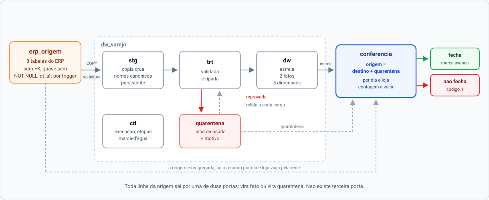
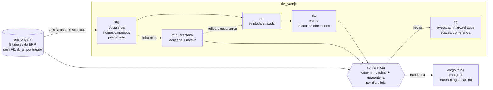

# Pipeline de integração com ERP de varejo


Integra o ERP de um supermercado num data warehouse em estrela: extração
incremental, camada de qualidade com quarentena e uma **conferência que
derruba a carga quando a conta não fecha**.

Postgres, Python e SQL puro. Sem dbt, sem orquestrador, sem serviço pago.

> **Os dados são 100% sintéticos.** O "ERP A" é um banco gerado por este
> próprio repositório, desenhado para imitar um ERP legado de verdade —
> inclusive nos defeitos. Nenhuma empresa real, nenhum dado pessoal, nenhum
> CNPJ.

---

## O caso

### Problema

Integrar ERP de varejo é fácil de fazer *parecer* pronto. Em uma tarde se
escreve um `SELECT` que joga venda num dashboard, e o gráfico aparece.

O problema é que os modos de falha reais não são o job quebrando — esses são
os fáceis, dão erro e alguém conserta. Os que machucam são silenciosos:

- O ERP grava uma venda **com data de alteração retroativa** (importação,
  contingência fiscal). A carga incremental lê "o que mudou desde ontem",
  a linha está marcada como de 15 dias atrás, e ela nunca é lida. Ninguém
  percebe.
- **Cancelar uma venda atualiza só o cabeçalho.** Os itens ficam intactos,
  com a data de alteração antiga. Quem extrai item por data de alteração
  nunca vê o cancelamento, e a receita fica inflada para sempre.
- Um item aponta para um produto que ainda não foi cadastrado. Um `JOIN`
  descarta a linha. O faturamento do dia fica menor e **nada no sistema
  registra que aquela linha existiu**.

Nos três casos o relatório sai bonito e a decisão sai torta. Um pipeline que
entrega número errado em silêncio é pior do que um que não roda.

### Decisão

O desenho inteiro foi organizado em torno de uma única pergunta que o pipeline
precisa saber responder com "sim" ou "não":

```
origem == destino + quarentena
```

Por dia e por loja, em contagem **e** em valor. Toda linha da origem sai por
uma de duas portas — vira fato ou vira quarentena, com o código da regra que a
reprovou. Não existe terceira porta. Linha sumir calado é o modo de falha que
este desenho recusa.

Disso decorre o resto:

| Decisão | Por quê |
|---|---|
| Staging **persistente**, com upsert por chave natural | A quarentena guarda referência, não cópia. A linha recusada é **relida do staging** a cada carga e reavaliada: cadastro que chega tarde não vira rejeição permanente. |
| O fato **mantém** os cancelados, com `cancelado = true` | Cancelamento vira métrica em vez de sumiço. Receita filtra `cancelado = false`. |
| Mapeamento origem → staging num **YAML**, não em código | Integrar um ERP novo é escrever um arquivo de configuração. Nenhum `.py` muda. |
| Janela de reprocessamento de N dias sobre a data de alteração | Recupera a linha gravada com data retroativa, até N dias. Além disso, a conferência **tem que falhar** — e falha. |
| A marca-d'água só avança no fim, e só se tudo passou | Carga que morre no meio é relida. Como tudo é upsert, reler não duplica. Avançar cedo perderia dado em silêncio. |

### Resultado

Medido na escala de 1 milhão de itens de venda (detalhes e método em
[docs/resultados.md](docs/resultados.md)):

| | |
|---|---|
| Carga completa do zero | **69,51 s** |
| Um dia de operação (72 mil itens novos) | **12,71 s** |
| Conferência da história inteira, a cada carga | **2,52 s** (4% do tempo) |
| Carga com atraso fora da janela | **reprova**, código de saída 1, marca-d'água parada |
| Testes | **107**, verdes, em 23 s |
| CI completo no GitHub Actions | **1m39s** |

E o teste que importa: quando o gerador injeta uma venda com 15 dias de atraso
e a janela de reprocessamento é de 7, a carga incremental **falha**, apontando
o dia exato e quantas linhas faltam. Não é sorte — é um teste que roda a cada
push.

---

## Como funciona



<details>
<summary>Mesmo diagrama em Mermaid (para editar)</summary>



</details>

Cada camada tem um trabalho e só um:

- **`stg`** copia e não julga. Nomes canônicos, tipos frouxos, nada descartado.
  É persistente de propósito: é o que permite reavaliar a quarentena.
- **`trt`** julga e não transforma mais nada. Toda linha sai validada ou
  quarentenada, com o motivo.
- **`dw`** é a estrela. `fato_venda_item` (grão: um item), `fato_estoque_dia`
  (denso, com indicador de ruptura), `dim_produto`, `dim_loja`,
  `dim_calendario` com feriados nacionais.
- **`ctl`** registra quem escreveu o quê, até onde leu e se a conta fechou.

Os dois bancos são separados **de propósito**: o Postgres não faz consulta
entre bancos, então a extração é obrigada a passar pela rede, como seria com
um ERP de verdade. Não há como "colar" na origem por acidente.

---

## Rodando

Requer Docker e Python 3.13.

```bash
cp .env.example .env && docker compose up -d
```

```bash
pip install -r requirements.txt && pip install -e .
```

O `-e .` instala o pacote `pipeline` no ambiente; sem ele, `python -m
pipeline.*` não encontra o módulo.

```bash
python -m pipeline.gerador --escala pequena --semente 42
```

```bash
python -m pipeline.carga --completa
```

A saída termina com a conferência:

```
  conferencia venda_item    126 grupos (dia x loja) conferidos. tudo bate
  conferencia estoque_mov   120 grupos (dia x loja) conferidos. tudo bate
OK
```

Para ver a rede de proteção funcionando — um dia de operação que inclui uma
venda com 15 dias de atraso, fora da janela de reprocessamento de 7:

```bash
python -m pipeline.gerador --delta --semente 43 && python -m pipeline.carga --incremental
```

```
FALHA: a conferencia nao fechou: origem != destino + quarentena
  venda_item:  4 de 131 grupos (dia x loja) divergem; faltam 28 linha(s)
  estoque_mov: 4 de 124 grupos (dia x loja) divergem; faltam 27 linha(s)
  A marca-d'agua NAO foi avancada. Se a causa for linha que o ERP gravou com
  dt_alt fora da janela de reprocessamento, o incremental nao alcanca ela:
  rode 'python -m pipeline.carga --completa'.
```

As 28 linhas faltando são exatamente os itens das 6 vendas que o gerador
injetou com 15 dias de atraso. Nem uma a mais.

Testes:

```bash
pytest
```

---

## Como eu integraria um ERP novo

O caminho abaixo é o que este repositório executa. Não é um plano — é o
procedimento que o código já suporta.

**1. Levantar tabelas, chaves e a coluna de alteração.** Para cada entidade
que interessa: qual tabela, qual a chave natural e qual coluna o ERP carimba
quando a linha muda. Essa última é a que define se dá para fazer incremental.
Se não existir, ou se não tiver índice, a conversa começa aí — sem ela, cada
carga é leitura da tabela inteira.

**2. Escrever o mapeamento.** Um arquivo em `config/conectores/<erp>.yaml`.
A chave é o nome canônico (o que existe no staging), o valor é como aquele ERP
chama:

```yaml
entidades:
  venda_item:
    tabela: mov_venda_item
    chave: [id_item]
    coluna_alteracao: dt_alt
    colunas:
      id_item: id_item
      cod_produto: cod_produto
      qtd: qtd
      vl_total: vl_total
    # Neste ERP, cancelar a venda mexe só no cabeçalho e o item fica com a
    # data de alteração antiga. Sem isto, o cancelamento nunca chegaria.
    reextrair_quando_pai_mudar:
      tabela_pai: mov_venda
      coluna_ligacao: id_venda
      coluna_ligacao_pai: id_venda
      coluna_alteracao_pai: dt_alt
```

Num ERP onde a coluna não vem pronta, o valor pode ser uma expressão SQL:
`vl_total: { expr: "qtd * vl_unit - coalesce(vl_desc, 0)" }`.

**3. Carga completa.** `python -m pipeline.carga --completa --conector <erp>`.
Ela lê tudo, popula as quatro camadas e já roda a conferência no fim.

**4. Conferir os totais com quem conhece o negócio.** A conferência prova que
nada se perdeu *no caminho*. Ela não prova que a regra de negócio está certa.
Abrir `ctl.conferencia` e `trt.quarentena` por motivo com o pessoal da
operação é o que transforma "fecha" em "fecha e está certo". Quarentena alta
num motivo específico quase sempre é regra mal entendida, não dado ruim.

**5. Ligar o incremental.** `--incremental`. A marca-d'água já está gravada
pela carga completa. Rodar duas vezes seguidas é inofensivo: tudo é upsert.

**6. Liberar o agendamento.** Só depois de ver a conferência fechar em cargas
incrementais seguidas. O agendador só precisa olhar o código de saída: 0 ou 1.

---

## Segurança

- **A origem é lida por um usuário que só tem `SELECT`.** `erp_ro` não tem
  `INSERT`, `UPDATE`, `DELETE`, `TRUNCATE` nem DDL. Isso não é confiança, é
  `GRANT` — e tem
  [teste](tests/sql/01_origem_seguranca_e_trigger.sql) que tenta escrever e
  exige que o banco recuse. Um pipeline de BI nunca deve ter como escrever no
  sistema que a empresa usa para faturar.
- **Credencial só entra por variável de ambiente.** O `.env` está no
  `.gitignore` e o CI falha se ele for versionado. Três papéis com senhas
  separadas: o dono da origem, o leitor da origem e o dono do DW.
- **Nenhum dado pessoal, nenhum CNPJ, nenhum CPF.** Os códigos de barras usam
  o prefixo GS1 200–299, reservado para uso interno de loja, que por definição
  não colide com produto de fabricante. Há teste verificando isso.
- **Carga repetível sem duplicar.** Tudo é `INSERT ... ON CONFLICT` por chave
  natural. Rodar a mesma carga duas vezes não muda nada — e tem teste
  comparando o antes e o depois.
- **O CI não usa nenhum secret.** As senhas são sorteadas pelo próprio job,
  mascaradas no log e descartadas com o container.

Uma ressalva honesta: **o arquivo de conector é código.** A escotilha
`{expr: ...}` é SQL interpolado direto na consulta. Nomes simples de coluna são
validados e compostos com `psycopg.sql.Identifier`, mas `expr` não é — por
desenho. Um `.yaml` de conector merece a mesma revisão que um `.py`.

---

## Resultados medidos

Todo número aqui saiu de uma execução real, com comando, data e máquina
registrados em **[docs/resultados.md](docs/resultados.md)**. Nada é estimado.

Máquina: Ryzen 7 5700X, 16 GB, SSD SATA, Postgres 16 em Docker com
configuração padrão.

| Escala | Itens de venda | Carga completa | Conferência |
|---|---:|---:|---:|
| pequena (30 dias) | 50.074 | 7,78 s | inclusa |
| média (120 dias) | 1.000.094 | 69,51 s | 2,52 s |

Um dia de operação sobre a base de 1 milhão de itens — 72 mil itens novos,
mais cancelamentos e chegadas tardias — entra em **12,71 s**.

Três achados que valem mais que os totais, porque mudaram o código:

- **Dimensão recarregada sem `ANALYZE` custava 57 s por carga.** A carga
  completa trunca a dimensão; até o autoanalyze passar, o planner acha que ela
  está vazia e escolhe o plano errado para o join de 1 milhão de linhas. Duas
  outras hipóteses foram testadas e descartadas antes dessa.
- **`PGHOST=localhost` custava 10 s por conexão.** O libpq tenta IPv6 antes do
  IPv4 e espera o timeout inteiro.
- **Chave estrangeira no fato custa 2,4× no `INSERT`** (8,72 s → 20,70 s).
  Ficam: são a garantia de que nenhum fato aponta para dimensão inexistente.

---

## Limites conhecidos

Escrito aqui porque limite que não está escrito vira surpresa na reunião.

- **`fato_estoque_dia` é denso.** Uma linha por dia × loja × produto desde o
  primeiro movimento do par, mesmo sem movimento — 720 mil linhas para 4 lojas
  × 1.500 produtos × 120 dias. É simples e bom para medir ruptura, mas não
  escala para milhões de pares × anos. Para isso, o caminho é guardar só as
  mudanças de saldo e reconstruir a densidade na consulta.
- **A conferência de estoque vai até a camada tratada, não até a estrela.**
  Como o fato de estoque é agregado, não há correspondência linha a linha. O
  que acontece da tratada para o fato denso não está coberto por conferência.
- **Chaves estrangeiras no fato** custam tempo na carga. Em volume maior, o
  caminho é soltá-las durante a carga e revalidar no fim.
- **Origem e DW no mesmo servidor Postgres.** São bancos separados e a
  extração passa pela rede, então o código não muda — mas a separação física
  real (e a competição por I/O) não está sendo exercitada.
- **Invalidação não cascateia.** Se um cadastro que já era válido passa a ser
  inválido, os fatos que apontam para ele continuam na estrela com a última
  versão boa da dimensão. A conferência continua fechando; o conteúdo é que
  envelhece.
- **Um ERP só.** O conector YAML foi desenhado para absorver um layout
  diferente sem mexer em código, e o staging já tem `sistema_origem` em toda
  chave — mas isso só estará *provado* quando um segundo ERP sintético passar
  pelo mesmo pipeline. É o próximo passo natural.

---

## Como foi construído

O caminho das seis etapas, com as decisões, as medições e as voltas erradas,
está em **[docs/construcao.md](docs/construcao.md)** — incluindo a caçada de
performance que derrubou a carga completa de 127 s para 64 s depois de duas
hipóteses erradas.

---

## Estrutura

```
config/conectores/     mapeamento origem → staging, por ERP (YAML)
sql/00_bootstrap/      papéis e bancos
sql/origem/            esquema do ERP sintético
sql/dw/                ctl, stg, trt e a estrela
src/pipeline/
  conector.py          lê e valida o YAML, monta o SELECT de extração
  extracao.py          origem → staging, por COPY entre os dois bancos
  tratamento.py        staging → tratada + quarentena
  estrela.py           tratada → estrela
  conferencia.py       origem = destino + quarentena
  carga.py             orquestra e decide se a carga passou
  gerador.py           gera o ERP sintético, com os defeitos de propósito
tests/                 107 testes
docs/resultados.md     todo número medido, com comando e máquina
docs/construcao.md     como o projeto foi construído, etapa por etapa
docs/pipeline.svg      o diagrama, para usar fora do GitHub
```

---

Gabriel Rangel · Rangel Analytics
